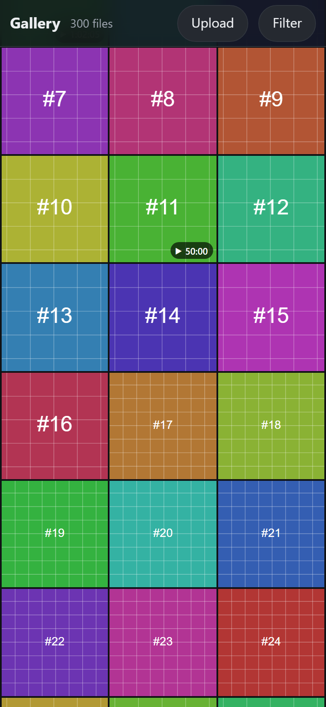
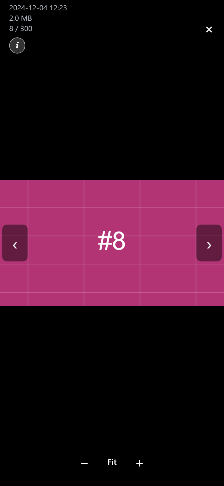
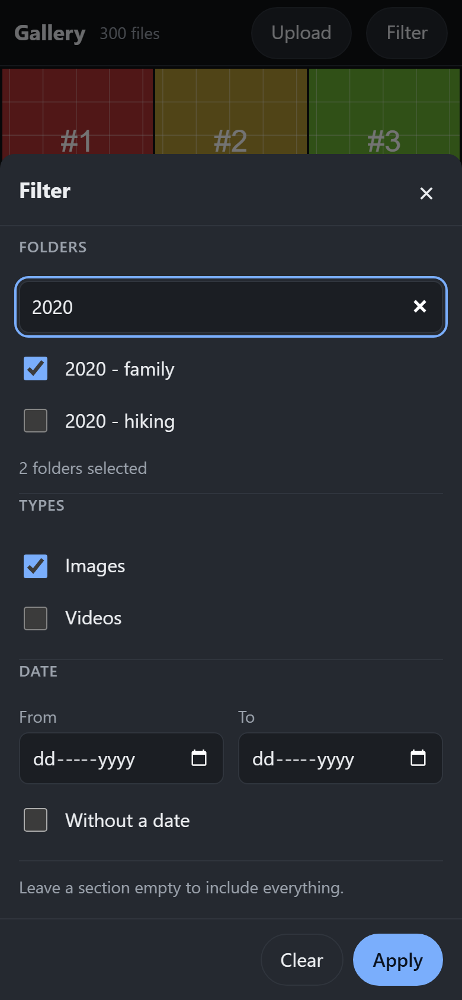
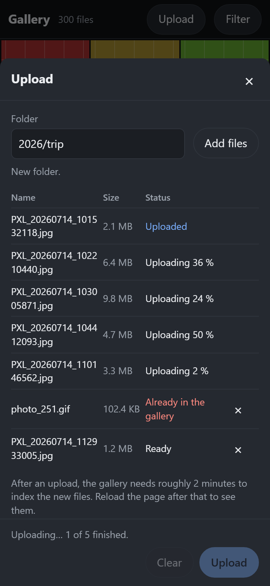
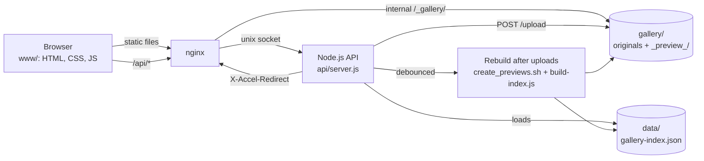

# gallery

A self-hosted, mobile-first photo and video gallery with uploads, built with **zero runtime dependencies**: the backend uses only the Node.js standard library behind nginx, and the frontend is plain HTML, CSS and JavaScript with no build step. Media is indexed with exiftool and gets previews from ImageMagick and ffmpeg.

**Contents:**
- [Screenshots](#screenshots)
- [Features](#features)
- [Architecture](#architecture)
- [Design decisions](#design-decisions)
- [Notable problems solved](#notable-problems-solved)
- [Repository layout](#repository-layout)
- [Run it locally](#run-it-locally)
- [Testing](#testing)

## Screenshots

<p>
  <a href="docs/screenshots/grid.png"></a>
  <a href="docs/screenshots/viewer.png"></a>
  <a href="docs/screenshots/filter.png"></a>
  <a href="docs/screenshots/upload.png"></a>
</p>

Grid, viewer, filter with folder search, and the upload overlay with per-file progress. The pictures are the mock server's generated test patterns.

## Features

- **Browsing:**
  - an infinite-scroll grid of previews, newest first
  - a full-screen viewer with swipe and arrow-key paging
  - pinch, double-tap, mouse-wheel and button zoom with panning
  - video playback
  - a details sheet with each file's metadata
- **Filtering:**
  - by folder, with a search box that narrows the list without deselecting anything
  - by type (images or videos)
  - by date range, including files without a date
- **Uploading:**
  - many files at once into an existing or a new folder, one request per file with live progress
  - checks in the browser before anything is sent: the name is already in the gallery, the same name or basename was picked twice, an unsupported type, a file over 2 GB, an invalid folder path
- **Behind the scenes:**
  - previews and the index are rebuilt automatically after a burst of uploads
  - the page downloads every file at most once
  - original filenames are kept on Android

## Architecture



nginx serves the frontend and proxies `/api/` to the Node.js API over a unix socket. The page loads the whole index once (`GET /api/get-files`); filtering and paging then happen in the browser.

**Serving a file:** the API checks the request and answers with an empty `X-Accel-Redirect` response. nginx then sends the bytes from an internal location, so Node.js never streams media.

**Uploads:** each upload is checked, stored and acknowledged on its own. Once a burst of uploads is over, the API runs the preview and index scripts once and reloads the index without a restart.

## Design decisions

- **No runtime dependencies.**
  - The API's multipart parser is written from scratch ([`api/multipart.js`](api/multipart.js)). It streams each file to disk and keeps memory per upload to about one network chunk.
  - The frontend has no framework and no build step; what's in [`www/`](www) is what's deployed.
- **The API authorises, nginx streams.** Media requests are checked in Node.js and handed back to nginx with `X-Accel-Redirect` ([`api/server.js`](api/server.js)), so range requests, `sendfile` and caching come from nginx.
- **Race-free stores that never overwrite.** An upload is written to a temp file and then `link()`ed under its final name ([`api/upload.js`](api/upload.js)).
  - `link()` fails atomically if the name exists, so two simultaneous uploads of the same name give exactly one `201` and one `409`.
  - A per-folder lock covers the rule that two originals in one folder can't share a basename, because their previews would collide.
- **Backpressure for bursts.** A batch of 100+ files arrives as 100+ parallel requests.
  - 8 are processed at a time and up to 500 wait; beyond that the API answers `503` with `Retry-After`.
  - One debounced rebuild runs per burst instead of one per file ([`api/reindex.js`](api/reindex.js)).
- **Defence in depth:**
  - path checks against encoded traversal (`%2F`) and symlinked directories
  - content sniffing so a renamed file is refused
  - a frontend that runs under a strict Content-Security-Policy, with no inline scripts or styles (the test nginx config and the mock server apply it)
  - deny-by-default file permissions set by [`api/deploy.sh`](api/deploy.sh): the service can't modify its own code
  - compatibility with systemd's `ProtectSystem=strict`, which `deploy.sh` checks before it changes anything
- **Deployments that fail safe.** Both deploy scripts check everything before changing anything. The API's script keeps the old service running until the final restart and health check; the frontend's swaps folders in whole.
- **A frontend built on platform features:**
  - native `<dialog>` overlays
  - pointer events for pinch and pan ([`www/js/zoom-pan.js`](www/js/zoom-pan.js))
  - `IntersectionObserver` for infinite scrolling
  - a media cache that keeps loaded ``/`<video>` elements ([`www/js/media-cache.js`](www/js/media-cache.js)), because the CSP rules out `blob:` URLs

## Notable problems solved

- **Uploads failed only on the server, with `EXDEV`.**
  - *Symptom:* under systemd's `ProtectSystem=strict`, every upload failed.
  - *Cause:* each `ReadWritePaths=` entry is its own mount, and a hard link from `data/` into `gallery/` crosses mounts. `/tmp` was read-only as well.
  - *Fix:* the upload temp folder moved inside `gallery/`, and the rebuild's temp files moved to `data/tmp/`.
- **Silent 502s.**
  - *Cause:* an error thrown while reading an upload ended the `for await` loop over the request. That destroys the request together with its socket, so nginx never got an answer. The code then mistook the destroyed request for a client abort and logged nothing.
  - *Fix:* the parser now drains the rest of the body after an error, and every error gets its own status and a log line.
- **Android uploads named `1000012345.jpg`.**
  - *Cause:* an image-only `accept` attribute makes Chrome on Android open the system Photo Picker, which hands over copies named after their media ID.
  - *Fix:* without the filter on Android, the Files picker passes the real name (`PXL_…jpg`). Unsupported files are still caught in the upload table.
- **`link()` rather than `rename()`.**
  - *Problem:* a move would silently replace an existing file, and checking first leaves a race.
  - *Fix:* `link()` creates the name only if it's free, in one atomic step. That's what makes "nothing is ever overwritten" hold under concurrency.
- **A misleading `ENOENT`.**
  - *Symptom:* `mkdir('data/upload-tmp', { recursive: true })` reported "no such file or directory".
  - *Cause:* `data/` was read-only for the service, and Node's recursive `mkdir` reports that as `ENOENT`.
  - *Fix:* `deploy.sh` now refuses to deploy when the unit's sandbox wouldn't let the service write to `gallery/` and `data/`, and it prints the line to add.

## Repository layout

| Folder | What | Docs |
|---|---|---|
| [`api/`](api) | The backend: the Node.js API, the index builder, the preview script, the deploy script and test tools | [`api/README.md`](api/README.md) |
| [`www/`](www) | The frontend: `index.html`, `css/`, `js/`, a mock backend for local work, and the deploy script | [`www/README.md`](www/README.md) |
| [`docs/`](docs) | The screenshots above | |

## Run it locally

Only Node.js (20 or newer) is needed to see the frontend against a mock backend:

```sh
cd www
npm start            # → http://localhost:8080
```

The mock serves the page with the production Content-Security-Policy and generates 500 files with every edge case the frontend handles. It also accepts uploads. To run the real API behind a user-level nginx, see [Local testing in `api/README.md`](api/README.md#local-testing).

## Testing

There's no unit-test framework; the project is checked at three levels:
- **API contract:** [`api/dev/test-api.sh`](api/dev/test-api.sh) talks to the running API over its socket. It checks every endpoint, the shape and order of `/get-files`, that every indexed file is served with the right type and `X-Accel-Redirect`, and a list of traversal and symlink attempts that must be refused.
- **Frontend against the mock:** [`www/dev/mock-server.mjs`](www/dev/mock-server.mjs) reproduces the API's data and edge cases and counts every media request (`GET /__stats`), so it can confirm that the page never downloads a file twice.
- **Manual checklist:** the [checklist in `www/README.md`](www/README.md#manual-test-checklist) covers every feature on a phone-sized screen.
